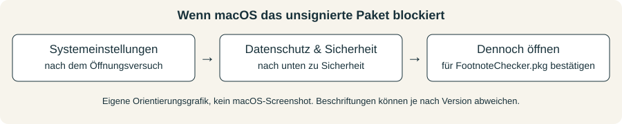
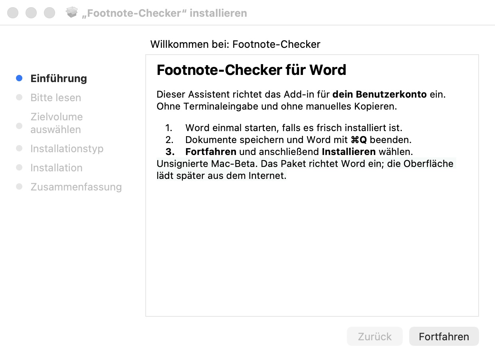
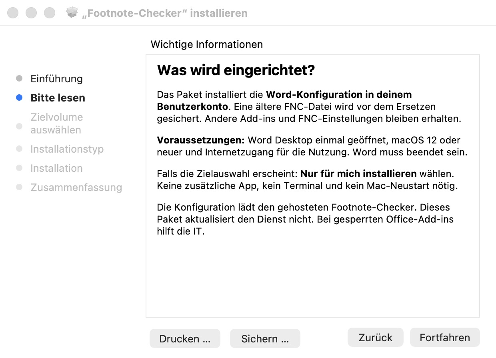
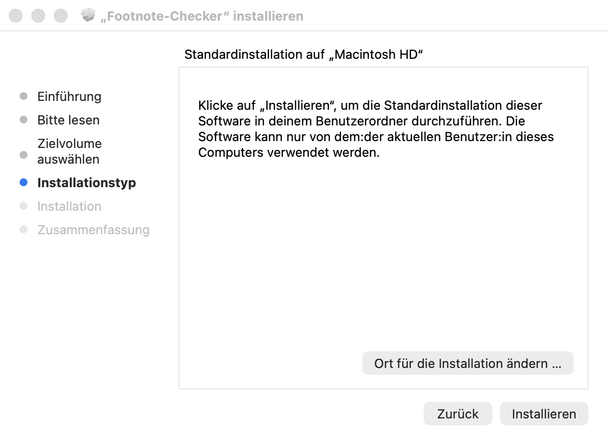
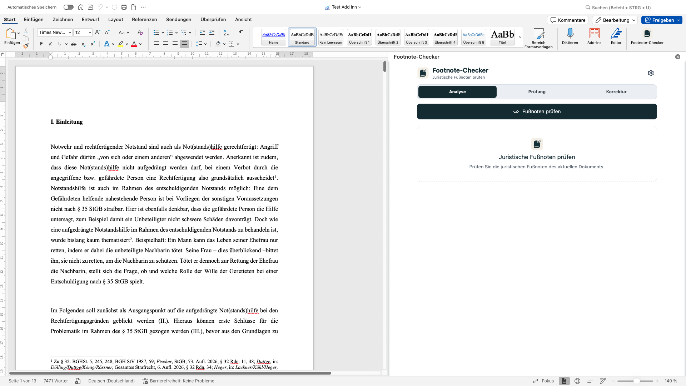

# Footnote-Checker auf dem Mac installieren

**Unsignierte Mac-Beta · Installer 0.1.0 · Anleitung vom 21. Oktober 2026**

[Installer herunterladen](../downloads/FootnoteChecker.pkg) · [PDF herunterladen](../downloads/Footnote-Checker-macOS-Installation.pdf) · [HTML-Anleitung herunterladen](../downloads/Footnote-Checker-macOS-Installation.html)

Der lokale Installationstest wurde vom Nutzer am 21. Oktober 2026 bestätigt. Das Paket richtet den Footnote-Checker für das eigene Benutzerkonto ein; Gatekeeper- und Organisationsdialoge können je nach Mac abweichen.

## 1. Vorbereiten und öffnen

1. Auf dem Mac muss **Microsoft Word Desktop** installiert sein. Word für dein Benutzerkonto einmal öffnen, falls es frisch installiert ist. Das PKG setzt macOS 12 oder neuer voraus; dies garantiert nicht jede Word-Version.
2. Offene Dokumente speichern. Word über **Word → Word beenden** oder **Cmd+Q** vollständig beenden. Ein geschlossenes Dokumentfenster reicht nicht.
3. **FootnoteChecker.pkg** herunterladen bzw. die lokal bereitgestellte Datei verwenden. Ein ZIP ist nicht nötig. Falls du das optionale ZIP nutzt, zuerst vollständig entpacken.
4. Im Finder **Downloads** öffnen und **FootnoteChecker.pkg** doppelt anklicken.

## 2. Nur bei einer Gatekeeper-Warnung: bewusst freigeben

Das Paket ist derzeit **nicht signiert und nicht notarisiert**. Falls macOS den Entwickler nicht bestätigen kann, ist eine Freigabe für genau diese vertrauenswürdig bezogene Paketdatei nötig.

1. Nach dem blockierten Öffnungsversuch die Meldung schließen; das Paket behalten.
2. **Apple-Menü → Systemeinstellungen → Datenschutz & Sicherheit** öffnen.
3. Nach unten zum Bereich **Sicherheit** scrollen und den Eintrag für **FootnoteChecker.pkg** suchen.
4. **Dennoch öffnen** wählen. Je nach macOS-Version kann die Formulierung ähnlich lauten. Wenn macOS eine Passwort- oder Touch-ID-Bestätigung fordert, direkt im macOS-Dialog bestätigen.
5. Die erneute Rückfrage mit **Öffnen** bestätigen. Nun startet der normale Installer.

Die Grafik zeigt den Weg, nicht eine nachgestellte Systemwarnung. Die Installer-Bilder darunter sind echte, am 21. Oktober 2026 aufgenommene Screenshots. Ein Gatekeeper-Dialog wurde für diese Bilder nicht nachgestellt. Auf macOS 12 heißt der Bereich je nach Version **Sicherheit & Datenschutz → Allgemein**. Bei Schadsoftware-/Beschädigt-Meldungen nicht fortfahren. Bei verwalteten Geräten ohne Freigabeoption die IT kontaktieren. Gatekeeper wird nicht global abgeschaltet. Ein neues Paket kann erneut eine Freigabe benötigen. [Apples Anleitung](https://support.apple.com/de-de/102445).

## 3. Den normalen Installer durchlaufen

1. In der Einführung auf **Fortfahren** klicken.
2. Die kurze Hinweisseite lesen und erneut **Fortfahren** wählen.

3. Falls eine Zielauswahl erscheint, **Nur für mich installieren** wählen. Die Standardinstallation ist für dein Benutzerkonto vorgesehen, nicht für andere Benutzer dieses Macs.
4. **Installieren** klicken. Keine Terminalbefehle, kein zusätzliches Script und keine App zum Verschieben in „Programme“ erforderlich. Für die benutzerbezogene Installation sind keine Administratorrechte vorgesehen; Gatekeeper oder macOS können trotzdem eine eigene Bestätigung verlangen.

5. Falls der Installer dich auffordert, Word zu schließen: Dokumente sichern und Word regulär beenden. Nicht ungespeichert erzwingen.
6. Warten, bis der Installer den erfolgreichen Abschluss meldet, dann **Schließen** wählen. Ein Mac-Neustart ist nicht nötig.

Die Aufnahmen zeigen Installer 0.1.0 auf macOS. Der Nutzer hat den lokalen Installationstest bestätigt; die Screenshots dokumentieren die einzelnen Schritte, nicht eine nachgestellte Erfolgsmeldung.

## 4. Footnote-Checker in Word öffnen

1. Word starten und ein Dokument öffnen.
2. **Start → Add-Ins → Footnote-Checker** wählen. Je nach Word-Version unter **Weitere Add-Ins / Meine Add-Ins / Entwicklertool-Add-Ins** nachsehen.
3. Zuerst eine **Dokumentkopie** im Modus **Analyse** prüfen. Dabei wird der Dokumenttext nicht geändert.
4. Anschließend Zitiereinstellungen und Literaturverzeichnis öffnen; erst danach sichere Korrekturen testen.

Internet ist erforderlich: Das Paket registriert die Word-Konfiguration, die Oberfläche lädt vom gehosteten Footnote-Checker. Der Installer enthält keinen eingefrorenen POC-17.7-Anwendungsbuild und aktualisiert das Hosting nicht. Microsoft beschreibt diesen [Mac-Testinstallationsweg](https://learn.microsoft.com/en-us/office/dev/add-ins/testing/sideload-an-office-add-in-on-mac).

## Wenn etwas nicht klappt

| Meldung oder Problem | Nächster Schritt ohne Terminal |
| --- | --- |
| Word muss beendet werden | Dokumente speichern und Word mit Cmd+Q schließen; Installation erneut starten. |
| Word-Ordner fehlt | Word einmal öffnen, Dokument öffnen, Word beenden und Paket erneut starten. |
| Keine Freigabeoption / verwalteter Mac | IT um Freigabe bitten. Keine Sicherheitsrichtlinien ändern. |
| Zugriff auf den Word-Ordner wird verweigert | Falls macOS den Zugriff ausdrücklich anfragt, den Dialog prüfen; bei fortbestehendem Fehler Screenshot aufnehmen und melden. Nicht mit Terminalbefehlen improvisieren. |
| Add-in fehlt | Word vollständig beenden und neu öffnen, Dokument öffnen, Add-in-Menü erneut prüfen. |
| Add-in lädt nicht / leere Oberfläche | Internet-/Dienstverbindung und Office-Add-in-Freigabe prüfen. Eine erfolgreiche PKG-Installation allein beweist keinen funktionierenden Hostingdienst. |
| Installer meldet Fehler | Fehlermeldung und macOS-/Word-Version senden. Die vorhandene Konfiguration wird nicht absichtlich mit unvollständigen Daten überschrieben. |

## Was wird gespeichert? Aktualisieren und entfernen

Die Konfiguration liegt in `~/Library/Containers/com.microsoft.Word/Data/Documents/wef/manifest.production.xml`. Geänderte frühere FNC-Dateien werden unter `~/Library/Application Support/Footnote-Checker/Installer Backups/` gesichert. Identische Neuinstallationen erzeugen keine zusätzliche Sicherung. Andere Add-ins und deine lokal gespeicherten FNC-Einstellungen bleiben erhalten.

Für ein Manifest-Update das neue PKG bei beendetem Word erneut öffnen. Für reine Webcode-Updates ist normalerweise keine Neuinstallation nötig. Zum Entfernen Word beenden und ausschließlich die FNC-Datei über den Finder entfernen; keine anderen Manifestdateien oder den Word-Container löschen. Vor Cachebereinigung FNC-Einstellungen exportieren.

**Mac-Beta:** Der lokale Installationstest wurde bestätigt. Tests weiterer macOS-/Word-Versionen und verwalteter Geräte sowie einzelne Gatekeeper-/Update-Szenarien sind dadurch nicht automatisch abgedeckt.
